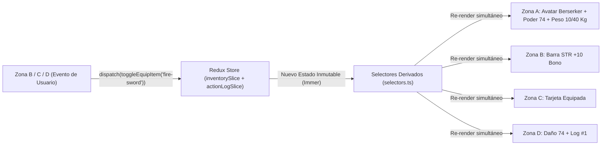

# ⚔️ HeroForge RPG — Arquitectura de Estado Visual con Redux Toolkit en React Native

> **Universidad de La Sabana** • Facultad de Ingeniería • Asignatura: **Desarrollo Móvil**  
> **Taller Práctico:** *"HeroForge RPG" — Arquitectura de Estado Visual con Redux Toolkit en React Native*

---

## 1. Descripción
**HeroForge RPG** es una aplicación móvil interactiva de estética *Dark Fantasy RPG* construida con **React Native (Expo)**, **TypeScript estricto** y **Redux Toolkit**. El proyecto demuestra de forma visual e inmediata cómo una arquitectura de estado global unidireccional y selectores derivados memoizados eliminan los antipatrones de *Prop Drilling* y *Estado Desincronizado*, haciendo que una sola acción (`dispatch`) actualice simultáneamente **4 Zonas Visuales Independientes** (*Efecto Dominó de Redux*).

---

## 2. Objetivos
1. **Eliminar el Prop Drilling:** Conectar cuatro componentes hermanos complejos (`HeroAvatarHUD`, `StatsControlPanel`, `ArmoryGrid`, `ReduxLiveInspector`) sin pasar estado ni callbacks por props entre ellos.
2. **Garantizar Consistencia Mediante Estado Derivado (Regla de Oro):** Calcular estadísticas totales, capacidad máxima de carga, sobrecarga, poder de combate y clase visual del héroe exclusivamente mediante selectores puros y memoizados (`createSelector`), sin almacenar cálculos redundantes en los slices.
3. **Visualizar el Ciclo de Redux en Tiempo Real:** Mostrar en la propia pantalla móvil tanto la reacción gráfica del avatar y sus barras como una Consola Redux en vivo alimentada automáticamente con las últimas 5 acciones reales despachadas (`extraReducers` + `builder.addMatcher`).

---

## 3. Stack Tecnológico
- **Framework Móvil:** React Native `0.81.5` + Expo SDK `54` (`~54.0.36`)
- **Lenguaje:** TypeScript `~5.9.2` (`strict: true`)
- **Gestión de Estado Global:** `@reduxjs/toolkit` `^2.6.1` + `react-redux` `^9.2.0` (con **Immer** integrado)
- **Testing Automatizado:** Jest `^29.7.0` + `jest-expo` + `@testing-library/react-native` `^13.2.0`
- **Calidad de Código:** ESLint `^9.21.0` + `typescript-eslint`

---

## 4. Requisitos Previos
- **Node.js:** `>= 20.19.4` (verificado en `v20.20.2`)
- **npm:** `>= 10.x` (verificado en `10.8.2`)
- **Git:** `>= 2.x`
- **Opcional para ejecución en dispositivo físico:** App **Expo Go** (Android / iOS) o navegador web moderno para Expo Web.

---

## 5. Instalación
Clona el repositorio e instala las dependencias desde la raíz del proyecto:

```bash
git clone <URL_DE_TU_REPOSITORIO_GITHUB>
cd HeroForgeRPG
npm install
```

---

## 6. Ejecución
```bash
# Iniciar servidor de desarrollo Expo (muestra código QR y opciones de plataforma)
npm start

# Abrir directamente en Android (Emulador o dispositivo conectado por ADB)
npm run android

# Abrir directamente en Navegador Web
npm run web

# Ejecutar verificación de tipos TypeScript (strict)
npm run typecheck

# Ejecutar linter ESLint
npm run lint

# Ejecutar suite completa de pruebas automatizadas (Jest + RNTL)
npm test
```

---

## 7. Arquitectura del Proyecto
```text
HeroForgeRPG/
├── .agents/
│   └── rules/
│       ├── redux.md                  # Reglas de arquitectura Redux Toolkit
│       ├── ui-design.md              # Reglas de diseño Dark Fantasy RPG
│       └── quality.md                # Reglas de calidad, TypeScript y testing
├── assets/                           # Iconos y recursos de Expo
├── docs/
│   ├── Taller Desarrollo Movil - Redux Visual (HeroForge RPG).docx.pdf
│   ├── REQUIREMENTS_MATRIX.md        # Matriz de trazabilidad de requisitos (Págs. 1-11)
│   ├── VIDEO_SCRIPT.md               # Guion detallado para el video de 6:30 min
│   ├── RUBRIC_AUDIT.md               # Auditoría de cumplimiento de la rúbrica (100 pts)
│   └── PROGRESS.md                   # Registro de progreso de ingeniería
├── src/
│   ├── components/
│   │   ├── HeroAvatarHUD.tsx         # Zona A: Avatar dinámico y HUD de barras reactivas
│   │   ├── StatsControlPanel.tsx     # Zona B: Entrenamiento de atributos, presets y reset
│   │   ├── ArmoryGrid.tsx            # Zona C: Armería de 6 ítems y alerta de sobrecarga
│   │   ├── ReduxLiveInspector.tsx    # Zona D: Simulador de Boss y Consola Redux en vivo
│   │   └── __tests__/
│   │       └── HeroForgeApp.test.tsx # Pruebas de integración visual y Efecto Dominó
│   ├── store/
│   │   ├── index.ts                  # configureStore, RootState, AppDispatch y hooks tipados
│   │   ├── selectors.ts              # Selectores derivados memoizados (Regla de Oro)
│   │   ├── slices/
│   │   │   ├── statsSlice.ts         # Atributos base, puntos disponibles y HP del héroe
│   │   │   ├── inventorySlice.ts     # Catálogo de 6 objetos RPG e IDs equipados
│   │   │   └── actionLogSlice.ts     # Historial automático de las últimas 5 acciones
│   │   └── __tests__/
│   │       └── store.test.ts         # Pruebas unitarias de slices, reducers y fórmulas
│   └── theme/
│       └── rpgTheme.ts               # Paleta de colores y tokens Dark Fantasy RPG
├── App.tsx                           # Proveedor Redux y montaje de las 4 zonas sin props
├── eslint.config.mjs                 # Configuración de ESLint + TypeScript
├── package.json                      # Scripts, dependencias y configuración de Jest
└── tsconfig.json                     # Configuración TypeScript estricta (strict: true)
```

---

## 8. Explicación de Redux Toolkit en HeroForge RPG
En una aplicación con múltiples paneles interdependientes, usar únicamente `useState` obliga a elevar todo el estado al componente padre (*Prop Drilling*) o duplicar cálculos en varios componentes (*Estado Desincronizado*).

Con **Redux Toolkit**:
1. El **Store** (`src/store/index.ts`) actúa como **Fuente Única de Verdad** (*Single Source of Truth*).
2. Los **Slices** almacenan únicamente el estado mínimo crudo (atributos base, lista de IDs equipados y registro de eventos).
3. **Immer** permite escribir lógica de actualización clara dentro de los reducers manteniendo inmutabilidad estricta por debajo.
4. Los **Selectores Derivados** (`src/store/selectors.ts`) cruzan información de `statsSlice` e `inventorySlice` en tiempo real para calcular el mundo visual sin posibilidad de inconsistencia.

---

## 9. Los 3 Slices del Store

### 9.1. `statsSlice` (`src/store/slices/statsSlice.ts`)
- **Estado Inicial:** `{ availablePoints: 15, str: 5, agi: 5, int: 5, currentHp: 100 }`
- **Reducers:**
  - `incrementStat(PayloadAction<'str' | 'agi' | 'int'>)`: Resta `1` a `availablePoints` y suma `1` al atributo si `availablePoints > 0`.
  - `decrementStat(PayloadAction<'str' | 'agi' | 'int'>)`: Suma `1` a `availablePoints` y resta `1` al atributo validando que ningún atributo base baje de `1`.
  - `takeDamage(PayloadAction<number>)`: Reduce `currentHp` sin bajar de `0`.
  - `healHero(PayloadAction<number | undefined>)`: Restaura el HP del héroe hasta `100`.
  - `applyBuildPreset(PayloadAction<'WARRIOR' | 'MAGE' | 'ROGUE'>)`: Reasigna los 15 puntos disponibles en un solo `dispatch` (`WARRIOR`: 16/8/6, `MAGE`: 5/7/18, `ROGUE`: 7/17/6).
  - `resetStats()`: Restaura el estado inicial (`15` puntos disponibles, `5/5/5` y `100 HP`).

### 9.2. `inventorySlice` (`src/store/slices/inventorySlice.ts`)
- **Estado Inicial:**
  - `catalog`: 6 objetos RPG con `{ id, name, icon, category, bonusStr, bonusAgi, bonusInt, weight, description }`:
    1. **Espada de Fuego** (`+10 STR`, `+2 AGI`, `10 Kg`)
    2. **Escudo de Titanio** (`+2 STR`, `+2 INT`, `18 Kg`)
    3. **Báculo Arcano** (`+1 AGI`, `+12 INT`, `5 Kg`)
    4. **Botas Élficas** (`+10 AGI`, `+2 INT`, `2 Kg`)
    5. **Armadura Maldita** (`+2 STR`, `+6 INT`, `24 Kg`)
    6. **Amuleto del Dragón** (`+4 STR`, `+4 AGI`, `+4 INT`, `3 Kg`)
  - `equippedIds: string[]` (inicia vacío `[]`).
- **Reducers:**
  - `toggleEquipItem(PayloadAction<string>)`: Equipa el ítem si no está en `equippedIds`, o lo desequipa si ya está activo.
  - `clearEquipment()`: Vacía todo el equipamiento activo de golpe.

### 9.3. `actionLogSlice` (`src/store/slices/actionLogSlice.ts`)
- **Propósito:** Mantener las últimas **5 acciones reales** despachadas en la aplicación.
- **Arquitectura (`extraReducers` + `builder.addMatcher`):** Intercepta automáticamente todas las acciones cuyos tipos comienzan por `stats/` o `inventory/`, generando entradas reales con formato `[slice/action] -> payload` (ej. `[inventory/toggleEquipItem] -> "Espada de Fuego"`).

---

## 10. Selectores Derivados y Fórmulas Matemáticas (`src/store/selectors.ts`)
1. **`selectTotalStats`:** Suma atributos base (`statsSlice`) + bonos de todos los ítems equipados (`inventorySlice`).
2. **`selectMaxWeightCapacity`:**
   $$\text{Capacidad Máxima} = 10 + (\text{totalStr} \times 2)$$
3. **`selectTotalWeight`:** Suma de `weight` de todos los ítems equipados.
4. **`selectIsOverencumbered`:** Retorna `true` cuando $\text{totalWeight} > \text{Capacidad Máxima}$.
5. **`selectCombatPower`:**
   $$\text{rawPower} = (\text{totalStr} \times 3) + (\text{totalAgi} \times 2) + (\text{totalInt} \times 3)$$
   Si `selectIsOverencumbered` es `true`, aplica la penalización del 30%:
   $$\text{combatPower} = \text{Math.round}(\text{rawPower} \times 0.7)$$
   *(Además, en la interfaz se activa la advertencia visual separada de `-50% Velocidad` por sobrecarga).*
6. **`selectHeroVisualClass`:** Calcula la clase (`Novato`, `Berserker Implacable`, `Archimago Arcano`, `Asesino Sombrío`, `Tanque Pesado`), arquetipo, color de aura, ícono de arma equipada y estado vital (`Sano`, `Herido`, `Derrotado`).

---

## 11. Componentes (Las 4 Zonas Visuales Independientes)
- **Zona A — `HeroAvatarHUD.tsx`:** Componente puramente reactivo (sin botones propios). Muestra avatar con aura dinámica, expresión vital, arma en mano, clase automática, poder de combate, estadísticas totales y barras de Vida (HP), Energía/Maná y Carga de Peso.
- **Zona B — `StatsControlPanel.tsx`:** Panel de entrenamiento con contador de puntos disponibles, controles `-` y `+` validados, barras de progreso base + bono, presets rápidos (`WARRIOR`, `MAGE`, `ROGUE`) y botón Poción de Reseteo.
- **Zona C — `ArmoryGrid.tsx`:** Cuadrícula de 6 tarjetas interactivas de equipamiento con bonificaciones, peso en Kg, estado equipado/desequipado con borde dorado brillante, botón `Desequipar Todo` y banner de sobrecarga `"⚠️ ¡SOBRECARGADO! (-50% Velocidad)"`.
- **Zona D — `ReduxLiveInspector.tsx`:** Arena de simulación contra el Boss *Ignis, Señor del Abismo* (250 HP) con ataque basado en `selectCombatPower`, contraataque real, curación y reinicio, junto con la Consola Visual de Redux en Vivo que muestra las últimas 5 acciones despachadas.

---

## 12. Flujo de Datos Unidireccional (El Efecto Dominó)


---

## 13. Pruebas Automatizadas
El proyecto cuenta con **19 pruebas automatizadas** distribuidas en 2 suites ejecutadas con **Jest** y **React Native Testing Library**:
- `src/store/__tests__/store.test.ts` (14 pruebas unitarias de reducers, casos borde, `extraReducers` y fórmulas de selectores).
- `src/components/__tests__/HeroForgeApp.test.tsx` (5 pruebas de integración completa de las 4 zonas, Efecto Dominó, sobrecarga, combate contra Boss y límite de 5 acciones en consola).

Para ejecutarlas:
```bash
npm test
```

---

## 14. Revisión Visual y Capturas
- Se verificó la compilación completa del bundle web con `npx expo export --platform web` y el árbol de renderizado de componentes mediante React Native Testing Library.
- **Nota de transparencia:** Dado que el entorno de ejecución terminal no tiene conectado un emulador Android físico con captura de pantalla activa en esta sesión, la inspección visual interactiva en pantalla queda lista para ejecutarse con `npm run web` o `npm run android`.

---

## 15. Instrucciones para Subir a GitHub
El repositorio local ya cuenta con Git inicializado y `.gitignore` configurado. Para publicarlo en tu cuenta de GitHub:

```bash
git add .
git commit -m "feat: complete HeroForge RPG with Redux Toolkit, derived selectors, 4 UI zones, and tests"
git branch -M main
git remote add origin https://github.com/<TU_USUARIO>/<TU_REPOSITORIO>.git
git push -u origin main
```

---

## 16. Limitaciones Conocidas
- El video explicativo de 5 a 7 minutos debe ser grabado por el estudiante (en cámara o narrando con su voz) siguiendo el guion listo para usar en `docs/VIDEO_SCRIPT.md`.
- La persistencia entre reinicios de la app es en memoria (comportamiento esperado por el taller para iniciar siempre con 15 puntos disponibles y demostrar el flujo limpio de Redux).

